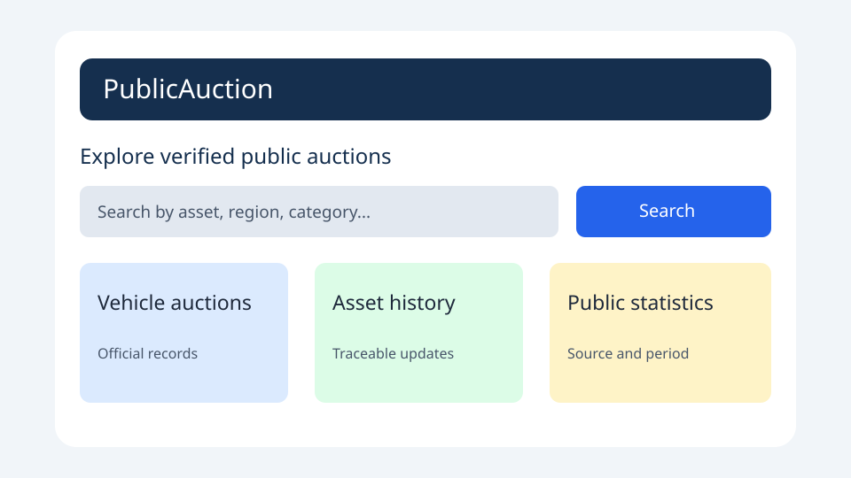

# PublicAuction

> **공공자산을 데이터로 비교하세요.**  
> 한국자산관리공사 온비드(OnBid)의 공매 물건을 검색·비교·분석하고, 원본 공고로 안전하게 연결하는 **모바일 우선 공공자산 탐색 웹서비스**.
>
> **프로젝트 단계: 요구사항·디자인 콘셉트·개발계획 수립 / 웹 앱 미구현 (2026-11-23 확인)**



> 위 SVG는 프로젝트용 디자인 콘셉트다. 실행 중인 앱의 스크린샷이나 실제 공매 데이터가 아니다.

## 0. 가장 중요한 제품 결정 (2026-11-23)

**지금은 웹페이지만 만든다.** 서비스는 **공매정보 조회·검색·추천·비교·분석·관심목록·공식 온비드 공고 이동**에 집중한다.

- **포함:** 온비드 공매 물건(자동차·일반 동산·부동산) 탐색, 지역/가격/기간 검색, 공고 상세, 데이터 기반 관심 유형 및 가격 분석, 과거 낙찰 통계, 북마크, 공고 상태 업데이트.
- **제외:** 입찰서 제출, 자동 입찰, 입찰 대리/매수신청 대리, 입찰보증금 납부, 결제·예치금 보관, 성공보수·대행 수수료 청구, 이용자 온비드 계정·인증서·비밀번호 수집.
- **금지:** 실제 온비드 서비스에 최저가격 미만의 시험 입찰을 보내는 테스트, 사용자 동의 없는 외부 입찰 행위, 미확인 가격/경쟁률을 사실처럼 표시하는 UI.
- **장기 아이디어:** 유료 분석, B2B 데이터, 적법한 전문가 제휴 등은 별도의 사업·약관·개인정보·법률 검토를 마친 후 새 의사결정으로 다룬다. 현 MVP의 개발 작업이 아니다.

**온비드 공매와 법원 경매는 다른 제도·데이터 흐름이다. MVP의 데이터 범위는 온비드 공매로 한정한다.**

## 1. 왜 만드는가?

온비드에는 공식 공고가 있지만, 여러 유형의 물건을 한꺼번에 비교하고, 공고 변경·종료를 확인하며, 과거 결과와 부대비용을 함께 판단하기는 번거로울 수 있다.

PublicAuction의 가설은 **'입찰 버튼'보다 '검증 가능한 탐색과 의사결정 정보'에 반복적으로 방문할 이유가 있다**는 것이다.

### 고객과 핵심가치

| 대상 | 해결하려는 문제 | 첫 제공 가치 |
| --- | --- | --- |
| 일반 탐색자 | 어떤 물건이 올라왔는지 찾기 어렵다 | 빠른 카테고리·지역·가격 검색 |
| 차량/동산 관심자 | 가격 및 상태 비교가 어렵다 | 동일 조건 비교와 비용 체크리스트 |
| 반복 탐색하는 전문 사용자 | 여러 공고를 수작업 모니터링한다 | 관심목록·상태변경·과거 낙찰통계 |
| 부동산 관심자 | 가격 이외의 권리·점유 위험을 놓치기 쉽다 | 원본 공고·유의사항·검증 필요 정보 분리 |

**North Star:** 공식 공고로 연결 가능한 *유효한 물건 상세 열람(verified detail view)* 및 주간 재방문. 입찰금액, 클릭 과장, '예상 수익'으로 제품 성과를 정의하지 않는다.

## 2. 제품 범위와 단계별 우선순위

| 구분 | 우선순위 | 기능 | 승인 기준 |
| --- | --- | --- | --- |
| 탐색 | P0 | 전체/차량/동산/부동산 카테고리 | 화면마다 정확한 물건 유형 |
| 검색 | P0 | 키워드·지역·금액·입찰기간·상태·정렬·페이징 | 공유 가능한 URL 필터, 빈 결과 처리 |
| 상세 | P0 | 사진(사용 허용 시), 공고번호, 감정가/최저입찰가, 기간, 보관장소, 출처 | 근거·갱신시각·원문 링크 표시 |
| 데이터 보호 | P0 | 변경/종료/취소 상태 동기화, 중복제거 | 종료 공고를 진행중으로 추천하지 않음 |
| 비교 | P1 | 최대 소수 개 물건 비교, 동일 가격 단위 및 조건 표시 | 결측값과 비교 불가 사유 표시 |
| 통계 | P1 | 과거 낙찰가·유찰·참여 현황(공개 범위) | 기간·표본·집계 단위 명시 |
| 추천 | P1 | 시장가격/위험/관심도 분리 | 검증 가능한 근거와 신뢰수준 |
| 개인화 | P1 | 관심물건 저장·상태변경 안내 | 로컬 우선, 알림 명시적 동의 |
| 콘텐츠 | P2 | 공매 용어·입찰 절차·위험 가이드 | 법적·투자 판단을 단정하지 않음 |
| 고급 분석 | P2 | 정식 수요 검증 후 분석 리포트 | 데이터 커버리지·품질 검증 |
| 실제 입찰/대행/결제 | **범위 밖** | 연동·서버 엔드포인트 모두 없음 | 별도 사업 의사결정 전 개발 금지 |

MVP에서 **세 자산 종류의 검색/목록은 제공**하되, 정교한 시세 추정은 **차량부터 검증**하고 이후 동산·부동산으로 확장한다. 단순 카테고리 공통 랭킹이 모든 자산의 가격 우위를 뜻하지 않는다.

## 3. 모바일 우선 화면 설계

한 화면에 지도·필터·통계·3D·목록을 모두 밀어 넣지 않는다. 사용자의 의사결정을 화면별로 나눈다.

| 화면 | 경로(제안) | 사용자 행동 |
| --- | --- | --- |
| 홈 | `/` | 서비스 이해 → 검색 또는 자산 유형 선택 |
| 물건 목록 | `/auctions` | 지역·가격·기간·유형 필터 → 정렬 |
| 물건 상세 | `/auctions/[id]` | 상태·가격·위험·출처 확인 → 공식 공고 열기 |
| 물건 비교 | `/compare` | 선택한 물건의 단위·조건 비교 |
| 데이터 인사이트 | `/insights` | 과거 결과·통계의 기간과 표본 확인 |
| 관심 항목 | `/saved` | 관심물건·관심검색 재확인 |
| 가이드 | `/guides/[slug]` | 공매 절차와 주의점 학습 |

**모바일(초기 가이드 ≤599px):** 단일 열, 하단 내비게이션 '탐색/관심/분석/가이드', 상세의 주 CTA는 **'온비드 공식 공고 확인'**. 필터는 별도 시트, 가격/위험은 펼쳐보기.  
**태블릿(600–1023px):** 상황에 따라 목록+상세 2분할.  
**데스크톱(≥1024px):** 검색·선택물건·인사이트 패널 배치 가능. 단, 모바일 콘텐츠와 비즈니스 규칙을 그대로 재사용한다.

- URL·새로고침·뒤로가기에 검색조건/선택 상태가 유지되어야 한다.
- 로딩·결과 없음·에러·오래된 정보·잘못된 공고 ID 상태를 명확히 구분한다.
- 3D/Three.js는 옵션이며 SEO·정보 접근·기본 기능에 필수 의존성이 되면 안 된다.
- 이미지는 저장소 자산 또는 사용 권리가 확인된 사진만 사용한다. 가상 샘플은 반드시 **데모 데이터**라고 표시한다.
- 세 개의 다른 웹프로젝트와 **코드·브랜드·라우트·세션·배포를 섞지 않는 독립 앱**이다.

자세한 화면 흐름 및 반응형 계약은 [모바일 우선 정보구조](docs/25_MOBILE_FIRST_INFORMATION_ARCHITECTURE.md)를 따른다.

## 4. 공식 데이터와 API 도입 절차

**공식 출처**
- [온비드 공매 검색](https://www.onbid.co.kr/op/cltrpbancinf/cltr/cltrcdtnsrch/CltrCdtnSrchController/mvmnCltrCdtnSrchClg.do)
- [공공데이터포털 — 한국자산관리공사 OpenAPI 목록](https://www.data.go.kr/tcs/dss/selectDataSetList.do?dType=API&orgNm=%ED%95%9C%EA%B5%AD%EC%9E%90%EC%82%B0%EA%B4%80%EB%A6%AC%EA%B3%B5%EC%82%AC)

**API 검토 후보 — 데이터셋 상세설명 수준의 목록. 실제 사용 가능성과 응답은 미검증.**

| 출처/항목 | 데이터 활용 목적 |
| --- | --- |
| [공고 상세](https://www.data.go.kr/data/15157218/openapi.do) | 공식 공고 기간·상태·조건 |
| [공고별 물건](https://www.data.go.kr/data/15157220/openapi.do) | 공고↔물건 연결 |
| [차량 물건 목록](https://www.data.go.kr/data/15157233/openapi.do) | 자동차 기본 탐색 |
| [동산 상세](https://www.data.go.kr/data/15157245/openapi.do) | 일반 동산 속성 |
| [입찰 결과 목록](https://www.data.go.kr/data/15157252/openapi.do) | 과거 종료/낙찰/유찰 탐색 |
| [입찰 결과 상세](https://www.data.go.kr/data/15157254/openapi.do) | 공개된 낙찰 결과 분석 |

**연동 선행 조건:** 실제 발급 키로 샘플 요청 → API 신청/약관·상업적 이용·이미지 이용범위 → 필드명·자료형·null·단위·상태코드 → 쿼터/페이징/갱신주기 → 공고·물건·결과 ID 매핑 → 샘플·계약 테스트를 기록한다. 데이터셋 이름이 있다는 이유만으로 모든 유형의 필드와 이미지가 존재한다고 가정하지 않는다.

**수집 원칙:** 원본 응답 스냅샷(비밀정보 제외) → 스키마 검증 → 정규화 → 중복 방지 upsert → 공고 변경 이력 → 검증된 읽기 모델 게시. 소스 장애 시 마지막 수집시각과 '정보 갱신 지연'을 표시하고 값을 만들어내지 않는다.

## 5. 추천/가격 분석의 정직한 정의

**감정가 ≠ 시세 ≠ 최저입찰가 ≠ 낙찰가 ≠ 총취득비용.** 이 값들을 혼용하지 않는다.

- **가격 매력도:** 비교 가능한 외부 시장가격 자료가 실제 확보된 경우에만 조건·시점·표본을 보정하여 제공. 확보 전에는 '시세 미검증'.
- **위험도:** 확인된 공고 조건, 물건 상태, 추가 비용, 권리/점유 문제, 데이터 결측 등을 개별 근거로 표시. 확인하지 못한 사항은 '미확인'이지 '안전'이 아님.
- **관심도:** 온비드의 공개된 *과거* 입찰 통계와 PublicAuction *자체* 열람·찜 집계를 구별. 현재 입찰자 수나 경쟁률을 추정해 사실로 표시하지 않음.
- **총비용 참고:** 자동차는 이전비·수리/보관/탁송, 동산은 운송/설치/상태, 부동산은 취득세/권리/명도 등 가능한 부대비용의 체크리스트. 자료가 없으면 숫자를 단정하지 않음.
- **추천 결과:** 근거 출처, 기준일, 표본수, 누락 필드, 계산 방법/버전, 신뢰수준 또는 '평가 불가'를 표시. 수익 보장·낙찰 확률 보장 표현을 사용하지 않음.
- **백테스트:** 과거 공고 마감 당시 **알 수 있던 정보만** 써서 평가한다. 미래 낙찰가를 입력 특성으로 사용하는 데이터 누수 금지.

'핫딜'은 검증 전 마케팅 명칭으로만 남기고, 기본 UI는 **'주목할 물건' 또는 '분석 가능한 물건'**으로 표현한다. 가격 우위가 확인되지 않으면 할인율을 표시하지 않는다.

## 6. 제안 아키텍처 (아직 구현되지 않음)

```text
Public OnBid / data.go.kr APIs  [READ ONLY]
             |
             v
Python ETL collector -> raw snapshot -> validation/normalization
             |                              |
             +------------------------------v
                              PostgreSQL (versioned source + read models)
                                          |
                                server-only typed query
                                          |
                           Next.js App Router (TypeScript)
                                          |
                  PublicAuction web (mobile / tablet / desktop)
                                          |
                             Official OnBid notice link
```

- **웹:** Next.js App Router + TypeScript, 서버 렌더링 페이지·URL 기반 필터·접근성.
- **수집:** Python + 형식 검증(Pydantic 제안) + 예약 배치 + 제한속도/백오프.
- **DB:** PostgreSQL, 공고/물건/입찰회차/결과/스냅샷/품질감사를 분리하고 공식 키에 유니크 제약 적용.
- **배포:** Vercel은 비상업 파일럿과 프리뷰 용도로 검토, Ubuntu 서버는 ETL/DB 후보. 호스팅 정책·상업 이용·HTTPS·가용성 검토 후 결정.
- **보안:** API 키/DB 자격증명은 서버만, 비밀값을 Git/클라이언트에 포함하지 않음. 사용자 입력 파라미터화, URL 화이트리스트, 속도제한, 콘텐츠 보안 정책, 로그 민감정보 최소화, 백업/복구 테스트.
- **API:** 필요한 경우 읽기 전용 GET 엔드포인트만 노출. 관리자 기능은 별도 인증·권한 관리·비공개 경로로 보호. **입찰/송금/대리 수행 API는 만들지 않는다.**
- **상태:** 오류 또는 공고 취소가 감지되면 추천에서 제외하고 공식 출처로 재확인 유도. 원본과 로컬 데이터가 충돌하면 원본 확인을 우선한다.

세부 구조: [아키텍처와 보안](docs/ARCHITECTURE.md), [데이터 및 비즈니스 로직](docs/DATA_AND_BUSINESS_LOGIC.md).

## 7. 검증: 실제 공매 입찰 0건으로 테스트

**테스트를 위해 실제 온비드에 입찰하지 않는다.** 최저가격 미만 무효 입찰, 실계정 자동 로그인, 입찰보증금 납부를 테스트 수단으로 사용하지 않는다.

1. **단위 테스트:** 금액/날짜 파싱, ID 매핑, 취소·진행·종료 판정, 누락치, 정렬 및 필터, 추천 점수의 계산·근거.
2. **계약 테스트:** 공개 API 응답 샘플을 픽스처로 저장(민감값·키 제거), 필수 필드·타입 변화 알림, 잘못된 API 응답의 fail-safe.
3. **통합 테스트:** 수집 → DB upsert → 중복/이력 → 읽기 API → UI 값/출처 연결, 소스 장애·재시도·갱신지연.
4. **과거 데이터 검증:** 낙찰 결과가 존재하는 사례의 공고 당시 데이터만 이용하는 백테스트. 자산 유형별 데이터 커버리지·오차를 별도 측정.
5. **UI E2E:** 검색→필터→상세→공식 링크; 모바일 뒤로가기·새로고침; 빈 결과/오류; 키보드·스크린리더.
6. **보안 테스트:** API 키 비노출, 인젝션, 부적절한 리다이렉트/SSRF, 접근 통제, 관리자 경로, 속도제한.
7. **회귀 테스트:** 375/430/768/1024/1440px 화면, 데이터 단위/출처/상태 변화, WebGL 없는 환경.

**TDD 원칙:** 실패하는 테스트 작성 → 최소 구현 → 통과 로그 및 증거 → 리팩터링 → PR별 수용 조건 확인. 실행하지 않은 테스트를 '통과'라고 쓰지 않는다.

**완료 정의:** 실데이터 검증 + 정확한 출처/갱신시각 + 핵심 흐름 E2E + 모바일·접근성 + 테스트·CI 증거 + 보안 검토. 화면의 디자인 콘셉트만으로 기능 완성을 선언하지 않는다.

## 8. 90일 실행계획 (목표, 확정 일정 아님)

| 시기 | 단계 | 주요 산출물 | 종료 기준 |
| --- | --- | --- | --- |
| 1–30일 | 데이터 기초 | API 계약 실증, 수집/DB, 목록/상세 페이지 | 실제 원본 연결·상태/중복/갱신 검증 |
| 31–60일 | 탐색 품질 | 모바일 UI, 검색 필터·비교·관심목록, 차량 통계/가격 평가 기반 | 핵심 E2E/정확도/접근성 테스트 |
| 61–90일 | 사용성 검증 | 추천 근거, 인사이트, 콘텐츠/SEO, 사용자 피드백, 운영 알림 | 데이터 신뢰도·유효 상세열람·재방문 측정 |

첫 유료 고객은 반복적으로 공매를 탐색하는 전문가일 가능성을 검증할 수 있으나, **초기 버전은 무료 정보 서비스**로 출시한다. 유료 서비스는 유료 전환 의향과 법적·데이터 이용조건 확인 뒤 판단한다.

## 9. 지표와 제품 의사결정

- **핵심:** 유효 물건 상세열람 수, 공식 공고 이동률, 주간 재방문.
- **탐색:** 검색 성공률, 0건 결과율, 필터 사용 후 상세 이동률, 검색/비교 완료 시간.
- **신뢰:** 출처 링크 오류율, 공고 상태 불일치율, 마지막 수집 지연, 필수값 누락률.
- **추천:** 자산유형별 평가 가능 비율, 비교 가격 표본, 과거 데이터 기반 오차, 추천 근거 열람.
- **실험:** 공매 경험자 인터뷰와 무료 탐색 반복 사용을 먼저 검증. 전환·매출·시장규모 수치는 실제 데이터가 없으면 추정치로 표시.
- **개인정보:** 필요한 최소 이벤트만 수집, 쿠키/알림은 목적과 동의/거부를 명확히 제공.

## 10. 저장소 문서 인덱스

### 제품/데이터/설계
- [제품 및 사업 요구사항](docs/PRODUCT_REQUIREMENTS.md)
- [데이터·비즈니스 로직](docs/DATA_AND_BUSINESS_LOGIC.md)
- [UX 및 검색·탐색](docs/UX_AND_GROWTH.md)
- [아키텍처·보안·운영](docs/ARCHITECTURE.md)
- [테스트와 로드맵](docs/TEST_AND_ROADMAP.md)
- [모바일 우선 페이지 플로우와 반응형 규칙](docs/25_MOBILE_FIRST_INFORMATION_ARCHITECTURE.md)

### Agent-driven TDD 및 공부 경로
- [19. 엔지니어링 원칙](docs/19_ENGINEERING_PRINCIPLES.md)
- [20. 코드 읽기와 학습 순서](docs/20_LEARNING_PATH.md)
- [21. 품질 게이트](docs/21_QUALITY_GATES.md)
- [22. 구현 스프린트](docs/22_IMPLEMENTATION_SPRINTS.md)
- [23. 홈서버/Vercel/도메인 비용](docs/23_OPERATIONS_AND_COST.md)
- [24. 창업자 액션 아이템](docs/24_OWNER_ACTION_ITEMS.md)
- [Agent 작업 규약](agent/AGENT_RULES.md)
- [Agent 작업 템플릿](agent/TASK_TEMPLATE.md)

**문서 우선순위:** 2026-11-23의 이 README 제품 범위 결정이 기존 문서의 장기 입찰·대리·결제 아이디어보다 우선한다. 구형 문서에 장기 Phase D가 남아 있어도 **현 MVP 포함을 뜻하지 않는다.** 상세 화면/기술 수용 기준은 링크된 문서를 따른다.

## 11. 현재 상태 — 무엇이 되었고 무엇이 안 되었나?

| 영역 | 상태 |
| --- | --- |
| 사업 가설/제품 요구사항/설계 문서 | 작성됨 |
| 독립 앱, 모바일 우선 화면 구조 | 명세 수립 |
| 저장소 SVG 디자인 콘셉트 | 존재 |
| Next.js 실행 가능한 웹페이지 | **미구현** |
| 실 API 키로 응답·쿼터·상업 이용 검증 | **미완료** |
| 수집 서비스/PostgreSQL 스키마/분석 엔진 | **미구현** |
| 동작하는 Three.js 렌더링 | **미구현; MVP 필수 아님** |
| 자동 테스트·CI·배포와 운영 증거 | **미구현** |
| 온비드 실제 입찰/대리입찰/결제 | **개발 범위 제외** |

### 개발자가 다음으로 해야 할 일

1. `apps/web` 최소 Next.js 프로젝트를 구성하고 모바일 홈/목록/상세의 라우팅 및 E2E 테스트부터 시작한다.
2. 공공데이터 사용 조건을 확인한 뒤 `services/collector`의 실제 API 1종으로 데이터 계약 테스트를 만든다.
3. 샘플/실데이터를 혼동하지 않는 UI 상태와 데이터 출처 컴포넌트를 공통화한다.
4. 차량 → 동산 → 부동산의 순서로 분석 가능 범위를 넓히되, 세 유형의 기본 탐색은 공통 화면으로 제공한다.
5. 각 작업 PR에는 테스트 실패/통과 증거, 화면 캡처, 배포/보안 영향, 초보 개발자를 위한 코드 읽기 설명을 포함한다.

---

**면책 및 사용자 보호:** PublicAuction은 공공자산을 탐색하고 공개 데이터를 이해하도록 돕는 정보 서비스다. 공식 공고·현장 확인·자격·권리관계·비용 판단을 대체하지 않으며 특정 물건의 수익이나 낙찰을 보장하지 않는다. 실제 입찰은 사용자가 공식 온비드에서 직접 판단하고 수행한다.
